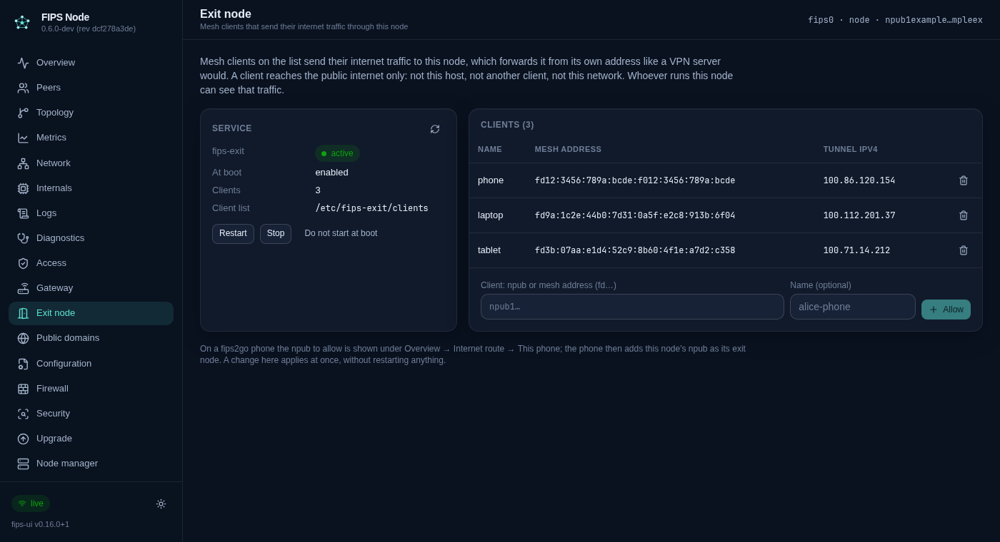

# Exit node

<!-- markdownlint-disable MD013 -->

[fips-exit](https://github.com/fr34aky/fips-exit) turns a Linux fips node into an **exit node**: mesh
clients on its list send their internet traffic to it over the mesh, and it forwards that traffic from
its own address, as a VPN server would. The clients are phones running
[fips2go](https://github.com/fr34aky/fips2go) (Overview → Internet route) or other fips nodes.



When fips-ui finds `fips-exit` on the node (`/usr/local/sbin/fips-exit` and `fips-exitd`), an **Exit
node** page appears in the sidebar. Viewers see:

- whether the `fips-exit` service is running and whether it starts at boot;
- the client list: each client's name, its mesh address, and its IPv4 address inside the tunnel. A
  client marked **not served** has the same tunnel address as an earlier one on the list (the address
  is derived from 22 bits of the mesh address, so this is possible though rare); the exit serves the
  first and leaves the second out until one of them is removed.

Admins also get:

- **Allow** a client, by npub or by mesh address (`fd…`), with an optional one-word name. On a fips2go
  phone the npub to enter is shown under Overview → Internet route → *This phone*. The change applies at
  once; nothing restarts.
- **Remove** a client. It is cut off at once.
- **Start**, **stop**, **restart** the service, and whether it starts at boot.

## What it changes on the node

Nothing by itself: fips-ui never writes fips-exit's files. Reading is unprivileged — the client list
(`/etc/fips-exit/clients`) is world-readable and the service state comes from `systemctl show`.
Changes go through the privileged helper (see [upgrade.md](upgrade.md) for that model), which gained
two verbs in **helper v14**:

```text
fips-ui-helper exit-add <fd-address> [name]    runs: fips-exit add <fd-address> [name]
fips-ui-helper exit-remove <fd-address>        runs: fips-exit remove <fd-address>
```

and accepts `fips-exit` as a unit for its `service` verb. The helper checks what it is given before it
runs anything as root: the address must be a fips address, the name one word of letters, digits, dot,
dash or underscore, at most 40 characters. An npub typed in the page is turned into its address by the
web backend (`fipsctl address`); the helper only ever sees the address. `fips-exit` itself then saves
the list and applies the routes, NAT and firewall rules, as it does from a shell.

After updating fips-ui, run `sudo ./deploy/setup-local.sh` once to install helper v14. Until then the
page shows the state and says what is missing.

## What an operator should know

The page manages the list. What an exit node means for the machine and its network is fips-exit's
subject, and its README says it plainly: the operator sees the clients' traffic, the internet sees the
exit's address, and a client reaches the public internet only (not this host, another client, or the
exit's own LAN).

The tunnel address shown per client is computed in the page's backend by the formula fips-exit and
fips2go share. It is for display; the exit derives its own.

## API

```text
GET  /api/exit/state                  {installed, unit: {active, enabled} | null, clients: [{address, inner, name, served}], clientsFile, error?}
POST /api/admin/exit/client           {who, name?}   who: an npub or a fips address
POST /api/admin/exit/client/remove    {who}
POST /api/admin/service               {unit: "fips-exit", action}
```

The read is open to every role; the writes need the admin role, are refused on a read-only instance,
and answer 409 while the installed helper is older than v14.
