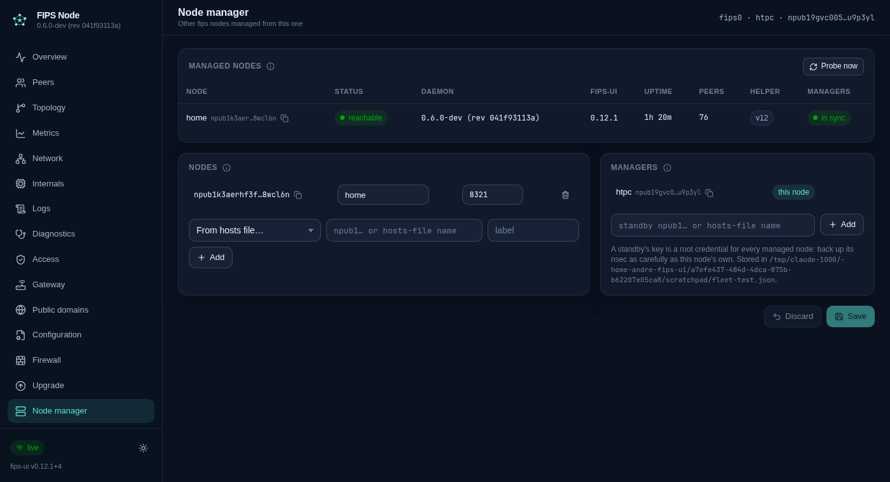
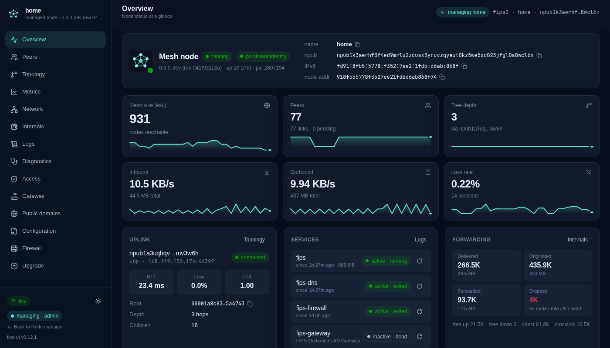

# The Node manager

One fips-ui instance (the *manager*) watches and manages other fips nodes that run fips-ui, through their own
APIs over the mesh. The page is **Node manager** in the sidebar, for superadmins.



## How a manager reaches a node

Every managed node runs fips-ui with **Web UI over the mesh** on ([mesh-access.md](mesh-access.md)) and lists
the manager's npub as an **admin**. A request that leaves the manager for the node's fips0 address arrives
there from the manager's own fips0 address, which FIPS derives from the manager's npub, so the node knows who
is asking without any token. The same channel carries hosts sync ([hosts-sync.md](hosts-sync.md)).

An admin over the mesh has the same rights as the node's local operator, so the manager can do on a managed
node everything its privileged helper allows: configuration, firewall, services, daemon upgrades, the fips-ui
self-update and the node's own access list. The node's local operator keeps the last word: removing the
manager from the node's access list ends that at once, and the manager shows the node as *not allowed*.

## Who may use the manager

An npub is a node, not a person ([mesh-access.md](mesh-access.md#roles)). If the manager node's admins could
all use the Node manager page, every admin npub granted on the manager would reach every managed node. So
the page needs the **superadmin** role: the manager's local operator has it, and an npub gets it only when a
superadmin grants it. Admins cannot grant, change or remove superadmin entries.

`FIPS_UI_READ_ONLY=1` turns the Node manager off.

## The overview

Every node in `~/.config/fips-ui/fleet.json` (`FIPS_UI_FLEET_FILE`) is probed every 30 seconds
(`FIPS_UI_FLEET_POLL_MS`), four at a time, through its `/api/health`, `show_status` and `/api/access`; its
update state (`/api/ui-update`, `/api/upgrade/status`, which ask GitHub) every fifth time or on **Probe now**.
The table shows for each node:

| Column | Meaning |
| ------ | ------- |
| Status | *reachable*; *offline* (no answer); *not allowed* (the node refuses the manager's npub, or its main listener answered because mesh access is off there or the port differs); *viewer only* (listed, but not as an admin); *not ready* (its mesh listener is up but its guard or identity is not); *restarting* (its fips-ui was told to update or to install fips); *error* (an unexpected answer). The last known versions stay while a node is away, with when it was last seen. |
| Daemon, fips-ui | The running versions, and a chip when the node's own release check found a newer one, or a daemon restart is pending there. |
| Helper | The node's privileged helper version; a warning when its fips-ui checkout ships a newer one (run `sudo ./deploy/setup-local.sh` there). |
| Managers | Whether every manager (see below) is an admin on that node. |

The manager's requests carry `user-agent: fips-ui-fleet`, so a managed node does not mistake them for a
hosts-sync follower.

## Opening a node

**Open** shows the managed node in this dashboard: every page (Overview, Peers, Logs, Configuration,
Firewall, Access, Upgrade, …) works on that node, with the rights its access list gives this node's npub (an
admin can do everything there, including its own access list and its fips-ui self-update). The address bar
reads `#/node/<npub>/<page>`; the header and the sidebar say which node is open and lead back.



Behind it, this node's backend forwards the browser's requests to the node's own API over the mesh
(`/api/fleet/nodes/<npub>/api/…`, GET and POST, streams included). Only `accept` and `last-event-id` travel
upstream, never this node's token or cookies; `set-cookie` never comes back. A node that answers with a
token prompt (its main listener instead of its mesh listener) is reported as unreachable rather than passed
through, so the manager's own token dialog never opens for it. A node that refuses this node's npub shows
what to do on it. When a managed node's fips-ui updates itself, it builds the new version first (minutes on
a small machine) and then restarts: the page waits and continues without reloading, and the overview shows
the node as *restarting* once it is away (probed every 15 seconds while still up, every five once away, for
up to 30 minutes) rather than offline.

## Standby managers and recovery

`fleet.json` also lists further manager npubs. The manager itself is always the first; the others are
*standbys*. Every manager should be an admin on every managed node (the overview says when one is not).

**Sync managers** (per node, or for every node that lacks one) reads the node's access list through its API,
adds the missing managers as admins (a manager listed as a viewer is raised to admin) and writes the list
back. Nothing is ever removed or demoted there: the node's operator keeps the last word. The list is read
and written in one go without a version check, so a change made on that node's Access page in the same
second could be lost; the next probe shows the result either way.

When the manager node is lost for good, or its key with it, start a node with a standby's backed-up nsec
anywhere: it is an admin on every managed node already. Copy or recreate `fleet.json` there, and it is the
new manager. From it, add a new standby and retire the old npub on the managed nodes.

A standby's key is therefore a root credential for every managed node. Back up its nsec as carefully as the
manager's own, and list only keys you control.

Without any standby, each managed node's local operator can still grant a new manager by hand on its
**Access** page.

## Files and endpoints

```
~/.config/fips-ui/fleet.json   { "nodes": [{ "npub", "label"?, "port" }], "managers": [{ "npub", "label"? }] }   (mode 0600)

GET  /api/fleet                the configuration, the managers, and what each node last answered;  ?refresh=1 probes them now
POST /api/fleet                {nodes, managers}: replace the configuration (superadmin, not in read-only mode)
GET|POST /api/fleet/nodes/<npub>/api/…   the node's own API, forwarded
POST /api/fleet/nodes/<npub>/sync-managers   every manager as an admin there;  POST /api/fleet/sync-managers for all nodes
```

A node cannot manage itself; the same npub may be managed and be a standby manager at the same time.
