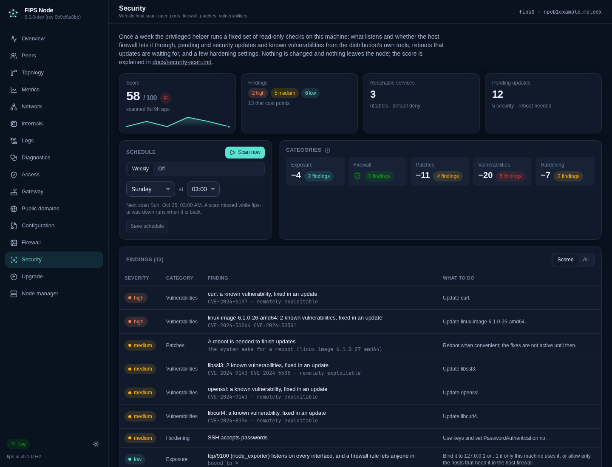

# Security scan

The **Security** page shows a weekly scan of the machine fips-ui runs on: which services listen and whether the
host firewall lets a new connection in, pending and security updates, known vulnerabilities in installed packages,
reboots that updates are waiting for, and a few hardening settings. Each finding comes with a fix, and the whole
report is scored 0–100 with a grade, so a change shows from one week to the next. The Node manager shows the grade
of every managed node ([fleet.md](fleet.md)).



The page is for admins: a list of what a node exposes is useful to an attacker too. The scan never changes the
system and nothing leaves the node; vulnerability data comes from the distribution's own tools.

## What is collected

The privileged helper (v13, Linux) runs a fixed list of read-only commands as root and passes their raw output to
fips-ui, which parses and scores it unprivileged (`server/security.ts`). The helper's `security-scan` takes no
arguments and no input, so a caller who can reach the endpoint can do nothing as root but read the facts below.
Every command runs under `timeout`, `nice` and `ionice`, and its output is capped at 256 KiB.

| Area | Commands |
| ---- | -------- |
| System | `/etc/os-release`, `uname -r`, the installed kernels (`/usr/lib/modules`), `/var/run/reboot-required`, `systemctl --failed` |
| Listeners | `ss -Htulnp` (root adds the process names) |
| Firewall | `nft -j list ruleset`, `ufw status verbose`, `firewall-cmd --list-all`, `iptables-save`, `ip6tables-save` |
| Updates and vulnerabilities | apt: `apt-get -s dist-upgrade`, the age of the package lists, `debsecan` if installed · dnf: `dnf makecache`, `check-update`, `updateinfo list --security` and its CVEs · pacman: `checkupdates` (pacman-contrib, its own temporary database), `arch-audit --json` if installed · zypper: `list-updates`, `list-patches -g security` |
| Restarts | `needs-restarting -r`, `needrestart -b` if installed |
| Hardening | `sshd -T`, a dozen `sysctl` keys, UID-0 accounts in `/etc/passwd`, the names of accounts with an empty password field in `/etc/shadow` (never the hashes), automatic-update timers, `timedatectl`, the modes of `fips.yaml`, `fips.key`, `fips.pub` and the hosts file |

Package metadata is only refreshed where that cannot change what is installed: dnf's cache and checkupdates'
temporary database. apt relies on the system's own `apt update` timer; lists older than a week are a finding.
On NixOS updates come from the flake, so the patch checks say so and score nothing.

For per-CVE detail install the distribution's tool: `debsecan` (Debian, Ubuntu) or `arch-audit` (Arch). dnf and
zypper report advisories themselves.

## Listeners and the firewall

Every listener is placed by what it is bound to: loopback (never scored), link-local or multicast, the LAN, a
public address, every interface, or the node's fips0 address. For each one fips-ui works out what the host firewall
does with a new connection from the LAN side (any interface but loopback and fips0) and, for IPv6 listeners on every
interface or on fips0, from the mesh:

- **nftables**: every base chain on the input hook is followed for that connection, jumps included. A rule that
  depends on the sender (source address, interface) makes it *some sources*; an expression fips-ui cannot read
  (an iptables-nft `xt` match, a named set) makes it *unknown*. Every chain on the hook must accept.
- **ufw** and **firewalld** (when they are active) by their default policy and their allowed ports and services.
  They write their own nftables tables (ufw through iptables-nft, which `nft -j` cannot express), so those tables
  are read from the tools and every other table on the input hook, such as fips's own `inet fips`, from nftables:
  a connection gets in only when both let it.
- **iptables** (legacy, with an empty nftables ruleset) by the INPUT policy and plain `--dport` rules.

UDP sockets in Linux's ephemeral port range (32768–60999) are clients (DNS, mDNS, QUIC, WebRTC), not services;
they are listed but not scored.

## Score

Every finding has a severity, and each severity takes a fixed number of points off 100. Each category can take
at most its cap, so one noisy area cannot hide the others. Any critical finding keeps the score at 59 or below.

| Severity | Points |
| -------- | ------ |
| critical | 25 |
| high | 10 |
| medium | 5 |
| low | 2 |
| info | 0 |

| Category | Cap | Examples |
| -------- | --- | -------- |
| Exposure | 30 | without a default-deny firewall: a database or Docker API port open to everyone (high, critical on every interface), any other TCP service (medium), SSH (low). Ports a default-deny firewall allows on purpose cost less: risky ones medium, others low, web (80, 443) nothing. A service every mesh node reaches (medium with nothing filtering fips0, low through a drop-in); fips-ui bound beyond loopback without `FIPS_UI_TOKEN` (high) |
| Firewall | 20 | no input filtering, or accept by default (high); fips-firewall not running (medium) |
| Patches | 20 | pending security updates (high; low, or medium from 10, where the vulnerabilities they fix are scored separately); other updates (low, medium from 50); stale apt lists, a pending reboot (medium); services on old libraries (low) |
| Vulnerabilities | 20 | per package with a fix available, at the distribution's severity (debsecan: its urgency); without a fix yet, listed but not scored |
| Hardening | 15 | an extra UID-0 account, a world-readable `fips.key` (critical); SSH root login with a password, accounts without a password (high); SSH password login, ASLR off, source routing (medium); kernel pointer and log restrictions, redirects, no automatic updates, unsynchronised clock, failed units (low) |

Grades: A from 90, B from 80, C from 70, D from 60, F below.

Where the firewall cannot be read, open ports cost points only for services that should never face a network; the
page lists what the scan could not cover.

## Schedule and storage

Scans run weekly at a chosen weekday and hour (default Sunday 03:00, local time), and on **Scan now**. A slot missed
while fips-ui was down runs when it is back; after a failed scan it is tried again an hour later. A scan takes from
seconds to a few minutes, mostly the package manager's metadata.

The schedule is kept in `FIPS_UI_SECURITY_FILE` (default `~/.config/fips-ui/security.json`), the newest 12 reports
in `security/` next to it, all mode 0600. `FIPS_UI_READ_ONLY=1` keeps the scheduled scans but refuses
**Scan now** and schedule changes.

## API

```
GET  /api/admin/security              schedule, running, next run, the latest report, whether the helper can scan
GET  /api/admin/security/history      score, grade and counts of the kept reports
GET  /api/admin/security/summary      the latest score and counts (the Node manager reads this)
POST /api/admin/security/scan         start a scan (202); poll GET until running is false
POST /api/admin/security/settings     {enabled, weekday (0 = Sunday … 6), hour (0-23)}
```
